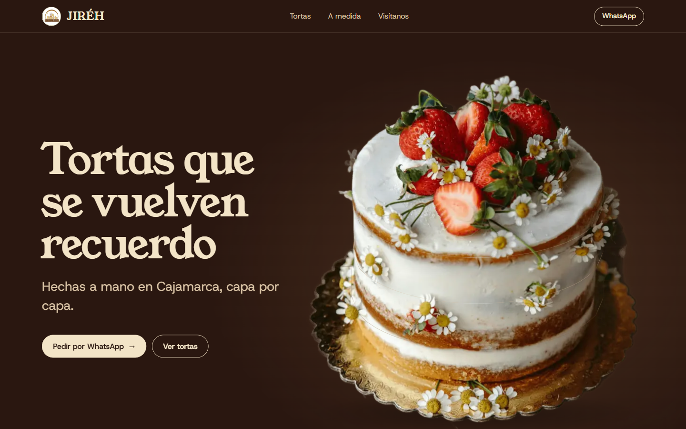
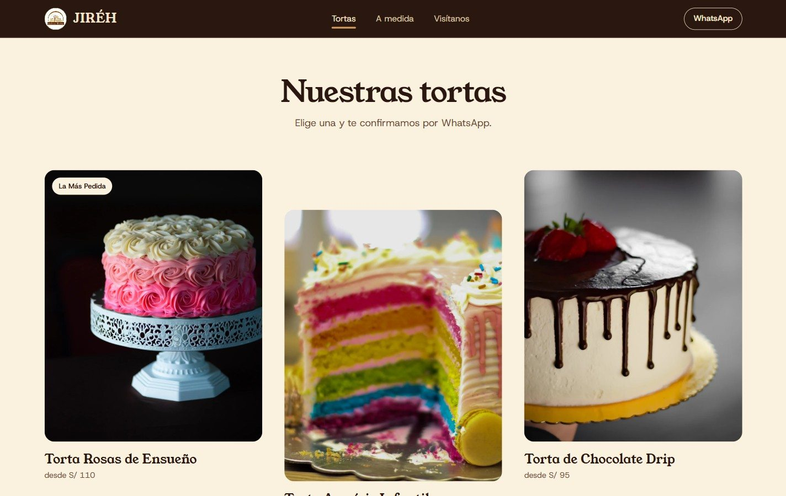
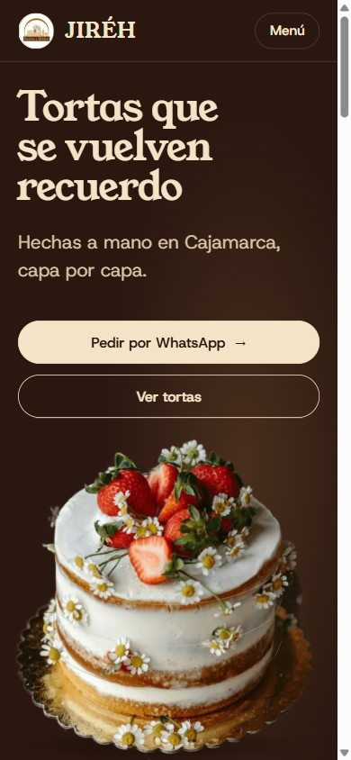
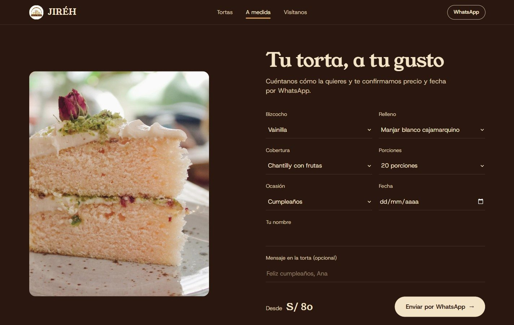

<p align="center">
  
</p>

<h1 align="center">JIRÉH · Panadería y Pastelería</h1>

<p align="center">
  <b>Tortas a medida · Cajamarca, Perú</b><br>
  Catálogo de tortas, "Arma tu torta" y pedidos por WhatsApp
</p>

<p align="center">
  <a href="#el-concepto">Concepto</a> ·
  <a href="#galería">Galería</a> ·
  <a href="#para-desarrolladores">Para desarrolladores</a>
</p>

<p align="center">
  
  
  
  
  
</p>

> **Tortas que se vuelven recuerdo.** Hechas a mano en Cajamarca, capa por capa.

## El reto

JIRÉH hace tortas para cumpleaños, infantiles, bodas y quinceaños. Sus clientes piden desde el celular y casi siempre quieren algo a medida: un bizcocho, dos rellenos, una cobertura. El sitio tenía un solo trabajo: **que el cliente elija o arme su torta y la pida por WhatsApp en menos de un minuto.**

## El concepto

**Las capas.** La página se arma como una torta: cada sección es una capa, de la cobertura a la base. La paleta sale literalmente del corte de una torta: ganache, bizcocho de vainilla, **manjar blanco cajamarquino** (el sello local) y la base dorada. El momento estrella es **"El corte"**: una tajada que se arma en vivo mientras el cliente elige bizcocho, rellenos y cobertura.

## Qué incluye

- 🎂 **Vitrina de tortas** con precio "desde", destacados y ficha de cada torta.
- 🍰 **Arma tu torta**: bizcocho, dos rellenos y cobertura, con la tajada que se dibuja en vivo y el resumen listo para enviar.
- 💬 **Pedido por WhatsApp** con el mensaje ya escrito.
- 🔐 **Panel de administración** (`/#admin`): catálogo, fotos y ajustes; obliga a cambiar la clave temporal en el primer ingreso y cierra la sesión por inactividad.
- 📒 **Libro de Reclamaciones** conforme a la Ley N.º 29571.
- ⚡ Tienda pre-renderizada en el HTML para que cargue rápido incluso con mala señal.

## Galería

<table>
  <tr>
    <td width="72%"></td>
    <td width="28%" rowspan="2"></td>
  </tr>
  <tr>
    <td></td>
  </tr>
</table>

## Seguridad

- Los visitantes **solo pueden leer** las tortas activas. Crear, editar, borrar o subir fotos exige una cuenta de administrador (reglas RLS de Supabase con una función en un esquema privado).
- Los reclamos (datos personales) solo los lee el administrador; se registran con una función protegida con límite de envíos y trampa para bots.
- Mientras la clave temporal no se cambie, la base de datos no permite editar nada.
- No hay claves secretas en el código: la clave de Supabase incluida es la pública.

El sistema de diseño completo (paleta, tipografía, grilla, movimiento y decisiones descartadas) está en [DESIGN.md](DESIGN.md).

## Créditos

Diseño y desarrollo: **Frank Abanto** ([@FrankUsqAbant](https://github.com/FrankUsqAbant)). Proyecto demo presentado al cliente.

---

## Para desarrolladores

<details>
<summary><b>Instalación, estructura y documentación técnica</b></summary>

### Correr en local

```bash
npm install
cp .env.example .env.local   # completar VITE_SUPABASE_URL y VITE_SUPABASE_KEY
npm run dev                  # http://localhost:5173
```

| Comando | Qué hace |
|---|---|
| `npm run dev` | Servidor local en el puerto 5173 |
| `npm run build` | Build de producción en `dist/`, con la tienda pre-renderizada en el HTML |
| `npm run lint` | Revisión de tipos (TypeScript) |
| `npm test` | Tests (`src/**/*.test.ts`) |

### Estructura

```
src/
  App.tsx                 tienda (secciones y modales)
  components/             secciones de la tienda
  data/bakeryData.ts      textos y catálogo de respaldo
  lib/supabase.ts         configuración de Supabase
  lib/catalog.ts          catálogo público (lee Supabase; si falla, usa el de respaldo)
  admin/                  panel /#admin (se descarga solo al entrar)
    AdminApp.tsx          inicio de sesión, cambio de clave temporal, cierre por inactividad
    AdminProductsPage.tsx catálogo, formulario de torta, ajustes
    adminApi.ts           operaciones contra Supabase
supabase/                 migraciones SQL y catálogo inicial (ver supabase/README.md)
scripts/                  generar-seed.ts (catálogo inicial) y prerender.mjs (HTML de la tienda)
fotos-fuente/             mosaicos originales del Facebook del cliente (no se publican)
DESIGN.md                 concepto "Las capas", paleta, tipografía, movimiento y decisiones
```

### Panel de administración

Entrar a `/#admin`. La clave temporal de la cuenta de la demo se entrega aparte (nunca se sube a git). En el primer ingreso el panel obliga a crear una contraseña propia; mientras tanto
la base de datos no permite editar nada.

</details>
